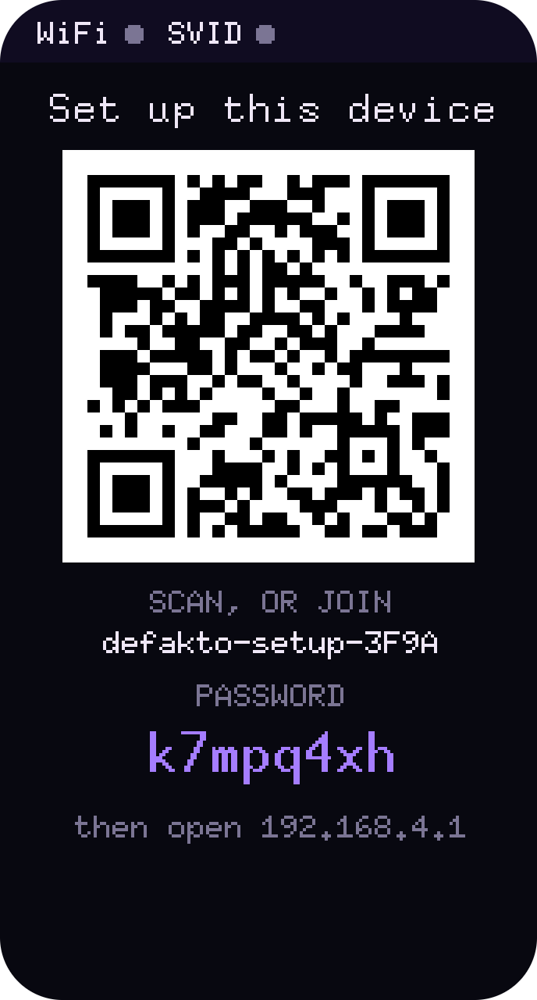
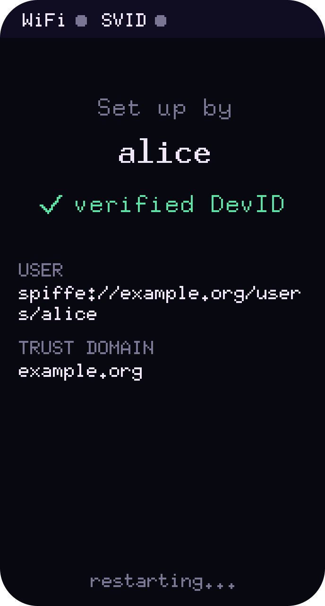
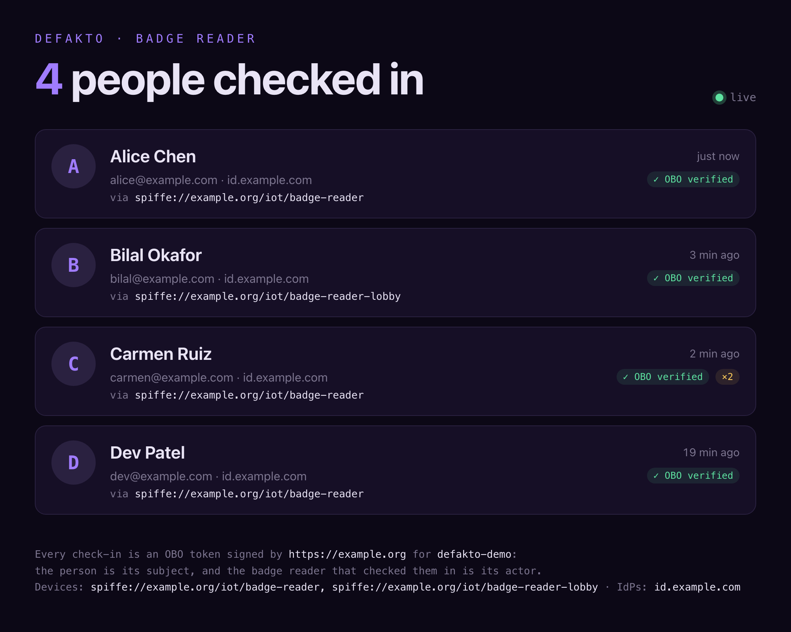

# Defakto check-in badge reader

A palm-sized check-in kiosk for offsites, meetups and remote sites, built on an ESP32-C6 and Defakto workload
identity. Put one by the door: attendees tap it, scan the QR code, and sign in on their phone with the company IdP.
The device then holds a token that proves two things at once: **who** checked in, and **which device** they checked
in through.

There's no shared API key baked into the device, and no user password ever touches it.

<p align="center">
  
  
  
  
</p>
<p align="center"><sub>Tap, scan, sign in on your phone, and you're checked in. (Renders, with example values.)</sub></p>

## How it works

1. **The device proves what it is.** At boot it attests to Defakto and receives a JWT-SVID, such
   as `spiffe://example.org/iot/badge-reader`. It attests in one of two ways: an HMAC over a secret burned
   into read-protected eFuse, or a token signed by the chip's ESP-TEE. The TEE's token also reports which firmware
   version is running. Defakto hands the evidence to this repo's attestor (`esp32-attestor`), which checks it.
2. **The attendee proves who they are.** A tap starts an OAuth device-code login (RFC 8628), and the screen shows
   a QR code. The attendee signs in on their own phone, and the device receives their ID token.
3. **Defakto binds the two together.** The device exchanges the attendee's ID token and its own SVID for an
   on-behalf-of token (RFC 8693). In that token, `obo.sub` is the attendee and `obo.act.sub` is the device's SPIFFE
   ID, and Defakto signs it.
4. **The check-in is recorded.** The device presents the OBO token to your check-in service, which verifies it
   against Defakto's trust bundle and records the attendee, the device and the time.

Because the check-in service verifies the token rather than trusting the device, it can also enforce policy: it
accepts check-ins only from enrolled devices, and only for users of your IdP.

## Setting one up

The firmware is open source. To deploy it, you:

- **Register an OIDC client** for the device-code grant with your IdP. Pocket ID and Auth0 are both tested.
- **Enroll the device with the attestor.** Add its secret or TEE key to the attestor's enrollment file (see
  [The attestor](#the-attestor)).
- **Enroll the device with Defakto.** Point an `extension` attestor at your attestor, and add a token-exchange policy
  that lets the device act on behalf of your IdP's users.
- **Flash it.** See [Building the firmware](#building-the-firmware).
- **Configure it from your phone.** On first boot it opens a setup wizard for the WiFi network, the IdP's device and
  token endpoints, the client ID, and the trust domain's issuer (see [The setup wizard](#the-setup-wizard)). You
  can also build these into `firmware/cfg.toml` beforehand (see `cfg.toml.example`).

## Building the firmware

On a Mac, you need:

- **Xcode's command line tools**, for git, Python 3 and a C compiler: `xcode-select --install`.
- **rustup**, from [rustup.rs](https://rustup.rs). The firmware builds on nightly, which `firmware/rust-toolchain.toml`
  pins and rustup installs on the first build. Homebrew's `rust` formula won't work, because it ignores that file. If
  you have it, put `~/.cargo/bin` ahead of it on your `PATH`.
- **ldproxy and espflash**, which link and flash the firmware: `cargo install --locked ldproxy espflash`. `flash.sh`
  needs espflash 4 or later.

Then, from `firmware/`:

```sh
./patch-idf.sh                  # once: fetches ESP-IDF v5.5.5 and applies the TEE flash-read fix
cp cfg.toml.example cfg.toml    # every value is optional; see "The setup wizard"
cargo run --release             # builds, flashes and opens the serial monitor
```

The first build also downloads ESP-IDF's toolchain (the RISC-V compiler, cmake and ninja) into `firmware/.embuild/`,
so it takes a while. On a board's first TEE flash, use `TEE_PROVISION=1 cargo run --release`, which gives the TEE a
fresh attestation key to enroll.

## The setup wizard

<p align="center">
  
  
</p>
<p align="center"><sub>Scan to join the device's network and configure it, and it shows who set it up. (Renders, with example values.)</sub></p>

A device needs no settings at build time. When its settings are incomplete, or when you hold the screen as it boots
(or press and hold BOOT just after power-on), it opens a setup wizard:

1. The screen shows a QR code that joins the device's own WiFi network, `defakto-setup-XXXX`, with a fresh random
   password beneath it.
2. Your phone opens the setup page by itself, as on hotel WiFi. If it doesn't, browse to `http://192.168.4.1`.
3. The page lists nearby networks and every setting `cfg.toml` holds. Saving stores them on the device, which
   restarts with them.

Settings saved this way take precedence over `cfg.toml`, which then only supplies defaults.

### Guarding it with a DevID

The password on screen only proves that someone is standing at the device. To let only people in your trust domain
set one up, add the trust domain's DevID issuer, and the SPIFFE IDs to accept, to `cfg.toml`:

```toml
devid_issuer = "https://fed.spirl.org/t-…/td-…"
devid_subjects = "spiffe://example.org/users/"
```

The setup page then asks for a [Defakto DevID](https://d.defakto.security/mint/dev-id/overview) JWT-SVID whose
audience is the device ID, and shows the command that fetches one:

```sh
defakto dev-id fetch jwt-svid --trust-domain example.org --audience badge-reader
```

Paste the token it saves into the page. With a Mac and an iPhone,
`pbcopy < ~/.defakto/dev-id/example.org/svids/jwt-svid` puts it on the phone's clipboard too. The device can't check
the signature while it's only an access point, so it restarts, joins the new network, and verifies the token against
the trust domain's keys before using the settings. The screen then shows who set it up, or why it refused the
settings, in which case it goes back to the wizard.

## The check-in endpoint


The device sends `POST <checkin_url>` with `Authorization: Bearer <OBO token>` and a body of `{}`. Any 2xx response
means the check-in was recorded. Anything else shows "Check-in failed" with the status code. Everything the service
needs is in the token, so it should check:

- the signature, against the trust domain's JWKS
- that `aud` is the service's own audience (`obo_audience` in `cfg.toml`)
- that `obo.act.sub` is a device it trusts
- that `obo.iss` is your IdP

Without a `checkin_url`, the device stops after the exchange and shows the token's claims.

## The check-in service

<p align="center">
  
</p>
<p align="center"><sub>The check-in page, live as people arrive. (Render, with example values.)</sub></p>

`checkin/` is a ready-made check-in endpoint. It does the checks above, keeps a list of who's checked in, and
serves a page at `/` that updates live as people arrive. Run it with your trust domain's issuer and the device's
`obo_audience`:

```sh
CHECKIN_ISSUER=https://… CHECKIN_AUDIENCE=defakto-demo cargo run -p checkin
```

Then open `http://localhost:8080` and point the device at it with `checkin_url = "http://<host>:8080/checkins"`.
Its settings can also live in `checkin/.env`:

| Variable | |
| --- | --- |
| `CHECKIN_ISSUER` | The trust domain's issuer. The service finds its signing keys through OIDC discovery. |
| `CHECKIN_AUDIENCE` | The `obo_audience` the device asks for. |
| `CHECKIN_DEVICES` | Optional, comma-separated: the device SPIFFE IDs allowed to check people in. Unset allows any. |
| `CHECKIN_USER_ISSUERS` | Optional, comma-separated: the user IdPs allowed. Unset allows any. |
| `CHECKIN_LISTEN` | Where to listen. The default is `0.0.0.0:8080`. |
| `CHECKIN_DATA` | Optional: a file to keep check-ins in, so they survive a restart. Unset keeps them in memory only. |

`CHECKIN_DATA` is a JSON Lines journal: the service appends each check-in and reset, and replays the file when it
starts. `POST /reset` empties the list. It has no authentication, so it listens only on `127.0.0.1:8081`. A reset
leaves the earlier check-ins in the file, but they're no longer replayed. To start a fresh demo in Kubernetes,
forward the admin port to the pod:

```sh
kubectl port-forward deploy/checkin 8081 &
curl -X POST localhost:8081/reset
```

`checkin/build.sh` tests the service, then builds a container image
for amd64 and arm64 and pushes it to `ghcr.io/dancavallaro/esp32-defakto-rust/checkin`, tagged `latest` and with the
version in `checkin/Cargo.toml`. Pass `--no-push` to only build.

## The attestor

`esp32-attestor` is an ESP32 extension attestor for Defakto. Defakto's `extension` attestor calls it as a webhook
whenever a device attests, so its `webhookURL` is this service's `/attest` endpoint, and its CA certificate must
trust the attestor's TLS certificate. It's the only thing that decides whether a device is genuine.

**The webhook.** Defakto sends `POST /attest` with a JSON body of `{"payload": "<evidence>"}`. If the evidence
checks out, the attestor answers with attributes, which Defakto exposes as `custom.*` for policies to match on. If
it doesn't, the answer is still a 200, carrying only an `error`, because Defakto gives up on any other status
without reading the reason. The real reason goes to the log. `GET /healthz` answers `ok`.

**The anchors.** A device attests with one of two anchors, and always gets `device_id` and `anchor` back:

| Anchor | `anchor` | How it's checked | Other attributes |
| --- | --- | --- | --- |
| HMAC | `hmac` | An HMAC-SHA256 over `device_id\|ts\|nonce`, with the device's enrolled secret. | |
| ESP-TEE | `tee` | The TEE's ECDSA P-256 signature, against the device's enrolled public key. | `app_version`, `app_digest`, `app_secure_version`, `tee_version`, `tee_digest`, `bootloader_digest`, `idf_version`, `secure_boot` |

Evidence must be fresh, within `--skew` seconds of now. A repeated nonce gets the first answer again, because
Defakto retries failed calls. `esp-attest/README.md` specifies the evidence formats, so read it if you're writing
another signer.

**Enrollment.** The enrollment file is a JSON object keyed by device ID. A device has a `secret` (32 bytes, base64),
a `tee_pubkey` (compressed P-256, hex), or both, so it can switch attestors without enrolling again:

```json
{
  "badge-reader-1": { "secret": "…", "tee_pubkey": "036d…b350" },
  "badge-reader-2": { "secret": "…" }
}
```

The `enroll` subcommands print entries to merge into it:

```sh
cargo run -p esp32-attestor -- enroll hmac badge-reader-1        # a new secret, its entry, and the nvs.csv to flash
cargo run -p esp32-attestor -- enroll tee badge-reader-1 <key>   # the entry for the key in the device's boot log
```

The TEE key is the one the device prints at boot as `TEE attestation key: …`.

**Running it.**

```sh
cargo run -p esp32-attestor -- serve --enrollment enrollment.json --tls-cert tls.crt --tls-key tls.key
```

| Flag | |
| --- | --- |
| `--listen` | Where to listen. The default is `0.0.0.0:8443`. |
| `--tls-cert`, `--tls-key` | The TLS pair. The defaults are `/tls/tls.crt` and `/tls/tls.key`. |
| `--enrollment` | The enrollment file. The default is `/enrollment/enrollment.json`. |
| `--skew` | The most an evidence timestamp may differ from now, in seconds. The default is 60. |
| `--reload-interval` | How often to check for changes, in seconds. The default is 30. |

**Reloading.** The attestor polls the enrollment file and the TLS pair, and picks up a change without a restart. If
the new file doesn't parse, it logs `keeping enrollment: …` (or `keeping TLS pair: …`) and carries on with the
one it has. A good one logs `enrollment reloaded: N devices`. It polls rather than watching because Kubernetes
updates a mounted Secret by swapping a symlink.

`attestor/build.sh` tests `esp-attest` and the attestor, then builds a container image for amd64 and arm64 and pushes
it to `ghcr.io/dancavallaro/esp32-defakto-rust/esp32-attestor`, tagged `latest` and with the version in
`attestor/Cargo.toml`. Pass `--no-push` to only build. The image runs `serve`, so mount the enrollment file and the
TLS pair at the default paths.

## Hardware

The device is a Waveshare ESP32-C6-Touch-LCD-1.47. A tap on the screen or the BOOT button starts a check-in. A long
press on the idle screen switches between eFuse and TEE attestation. Holding the screen as it boots opens the setup
wizard.

A Seeed XIAO ESP32C6 also works, headless and with TEE attestation only. It prints each screen to serial.

## Development

- `cargo test --workspace` runs the tests, including `esp-attest`'s golden vectors and the attestor's.
- `cargo run -p esp32-attestor -- serve …` runs the attestor, and `-- enroll …` prints enrollment entries.
- `cargo run -p demo-host -- svid` and `cargo run -p demo-host -- login` run the same flow from a Mac, without the
  hardware.

`CLAUDE.md` covers the code layout, the ESP-IDF patch and the TEE flashing details.
