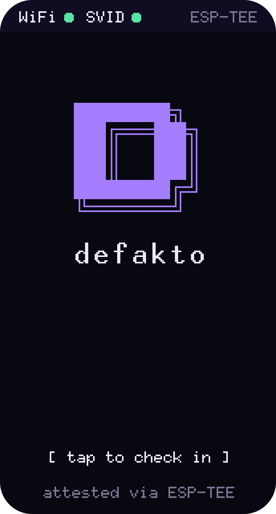
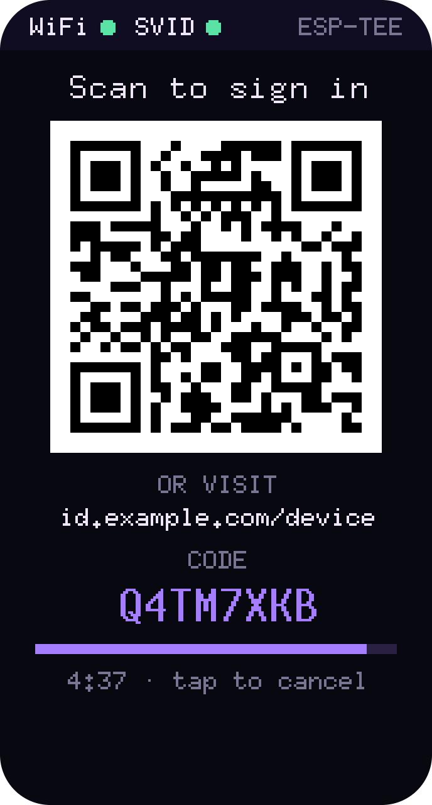
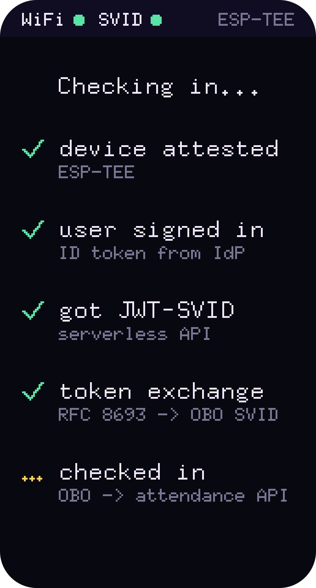
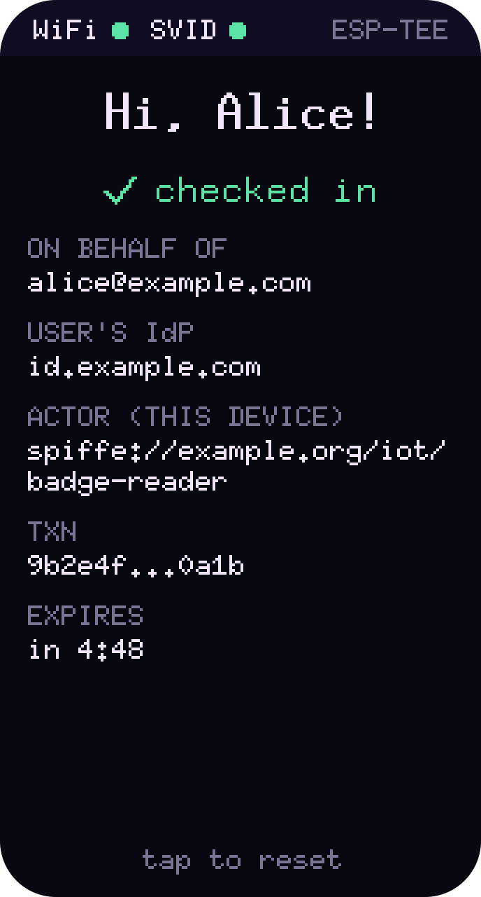
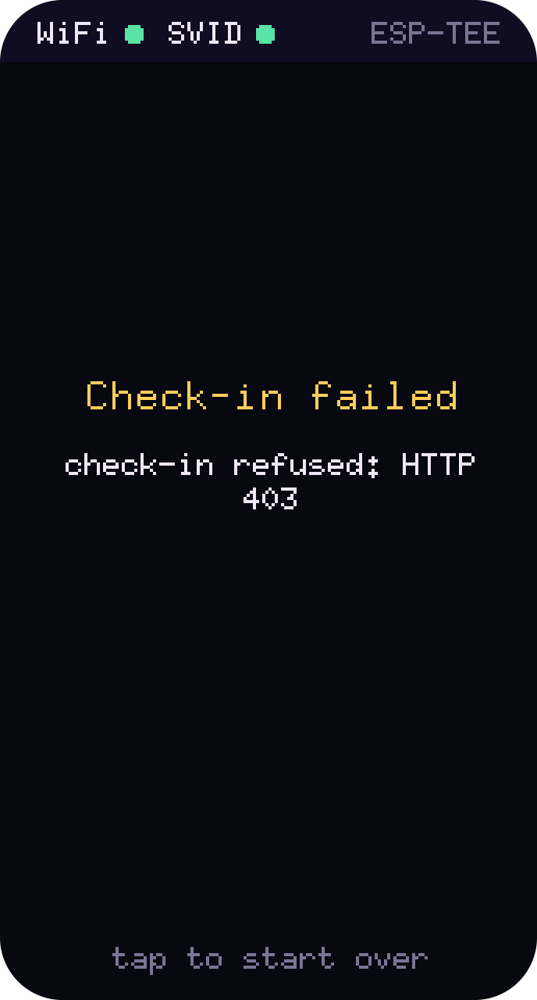

# Defakto check-in badge reader

A palm-sized check-in kiosk for offsites, meetups and remote sites, built on an ESP32-C6 and Defakto workload
identity. Put one by the door: attendees tap it, scan the QR code, and sign in on their phone with the company IdP.
The device then holds a token that proves two things at once: **who** checked in, and **which device** they checked
in through.

There's no shared API key baked into the device, and no user password ever touches it.

  
  
  
  

Tap, scan, sign in on your phone, and you're checked in. (Renders, with example values.)

## How it works

1. **The device proves what it is.** At boot it attests to Defakto and receives a JWT-SVID, such
   as `spiffe://example.org/iot/badge-reader`. It attests in one of two ways: an HMAC over a secret burned
   into read-protected eFuse, or a token signed by the chip's ESP-TEE. The TEE's token also reports which firmware
   version is running.
2. **The attendee proves who they are.** A tap starts an OAuth device-code login (RFC 8628), and the screen shows
   a QR code. The attendee signs in on their own phone, and the device receives their ID token.
3. **Defakto binds the two together.** The device exchanges the attendee's ID token and its own SVID for an
   on-behalf-of token (RFC 8693). In that token, `obo.sub` is the attendee and `obo.act.sub` is the device's SPIFFE
   ID, and Defakto signs it.
4. **The check-in is recorded.** The device presents the OBO token to your attendance service, which verifies it
   against Defakto's trust bundle and records the attendee, the device and the time.

Because the attendance service verifies the token rather than trusting the device, it can also enforce policy: it
accepts check-ins only from enrolled devices, and only for users of your IdP.

## Setting one up

The firmware is open source. To deploy it, you:

- **Register an OIDC client** for the device-code grant with your IdP. Pocket ID and Auth0 are both tested.
- **Enroll the device with Defakto.** Register its attestation key, and add a token-exchange policy that lets the
  device act on behalf of your IdP's users.
- **Fill in `firmware/cfg.toml`** (see `cfg.toml.example`). It holds the WiFi credentials, the IdP's device and
  token endpoints, the client ID, and the trust domain's issuer.
- **Flash it.** From `firmware/`, run `cargo run --release`.

## The check-in endpoint

The device sends `POST <checkin_url>` with `Authorization: Bearer <OBO token>` and a body of `{}`. Any 2xx response
means the check-in was recorded. Anything else shows "Check-in failed" with the status code. Everything the service
needs is in the token, so it should check:

- the signature, against the trust domain's JWKS
- that `aud` is the service's own audience (`obo_audience` in `cfg.toml`)
- that `obo.act.sub` is a device it trusts
- that `obo.iss` is your IdP

Without a `checkin_url`, the device stops after the exchange and shows the token's claims.

## Hardware

The device is a Waveshare ESP32-C6-Touch-LCD-1.47. A tap on the screen or the BOOT button starts a check-in. A long
press on the idle screen switches between eFuse and TEE attestation.

A Seeed XIAO ESP32C6 also works, headless and with TEE attestation only. It prints each screen to serial.

## Development

- `cargo test --workspace` runs the tests.
- `cargo run -p demo-host -- svid` and `cargo run -p demo-host -- login` run the same flow from a Mac, without the
  hardware.

`CLAUDE.md` covers the code layout, the ESP-IDF patch and the TEE flashing details.
